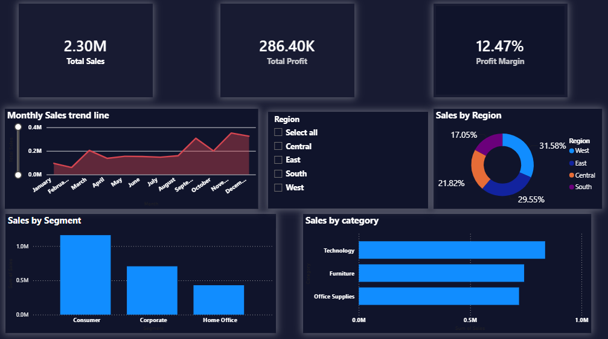

# Superstore Sales Performance Dashboard | Power BI

An interactive Power BI dashboard designed to evaluate sales performance, profitability, customer segments, and regional trends, translating raw sales data into actionable business insights.

## 1. Business Problem

Businesses need clear visibility into revenue performance, profitability, and customer buying patterns to make informed commercial decisions. However, raw sales data alone does not easily reveal underperforming regions, revenue concentration, seasonal demand, or opportunities to improve profit margins.

Objective: Develop an interactive business intelligence dashboard to monitor key performance indicators (KPIs), identify performance gaps, and support data-driven sales and profitability decisions.

## 2. Analytical Solution

Developed an interactive Power BI dashboard using the Superstore dataset sourced from Kaggle. The solution transforms raw transactional data into an accessible view of business performance.

Key implementation activities:

- Data Preparation: Cleaned and transformed data using Power Query.
- Data Analysis: Created DAX measures to calculate Total Sales, Total Profit, and Profit Margin.
- Data Visualization: Built interactive KPI cards, category and segment comparisons, regional sales analysis, and monthly sales trend charts.
- Performance Analysis: Evaluated regional revenue contribution, customer-segment performance, product-category sales, and seasonal patterns.

## 3. Key Outcomes & Business Insights

The analysis identified the following performance indicators and commercial opportunities:

KPI| Result
Total Sales| $2.30M
Total Profit| $286.4K
Profit Margin| 12.47%

Key findings:

- Regional Performance: West contributed 31.58% of sales, followed by East (29.55%), Central (21.82%), and South (17.05%). West and East together accounted for approximately 61% of revenue.
- Customer Segments: Consumer was the largest segment, generating approximately $1.16M in sales. Corporate and Home Office represent additional opportunities for targeted growth.
- Product Categories: Technology led category sales at approximately $0.84M, ahead of Furniture and Office Supplies.
- Seasonal Trends: Sales peaked in September, November, and December, while February recorded the lowest sales.

## 4. Business Recommendations

Based on the findings, the dashboard supports the following potential actions:

- Regional Growth: Investigate South's comparatively lower revenue contribution and identify opportunities to improve regional sales.
- Customer Expansion: Develop targeted campaigns for Corporate and Home Office customers to diversify revenue sources.
- Seasonal Planning: Align inventory, promotional campaigns, and marketing budgets with peak sales periods.
- Profitability Optimization: Review discounting practices and low-margin products to identify opportunities to improve profitability without relying solely on revenue growth.

These are data-driven recommendations; their financial impact would require further validation through implementation and follow-up analysis.

## 5. Tools & Technical Skills

- Power BI: Interactive dashboard development and data visualization
- Power Query: Data cleaning and transformation
- DAX: KPI calculations and analytical measures
- Data Analysis: Sales, profitability, regional, category, and segment analysis
- Business Intelligence: KPI monitoring, insight generation, and commercial recommendations

## 6. Dashboard Preview

## Project Deliverable

The repository includes the Power BI dashboard file (".pbix") and a dashboard preview image.

Project Focus: Converting raw sales data into actionable business insights to support performance monitoring and commercial decision-making.
